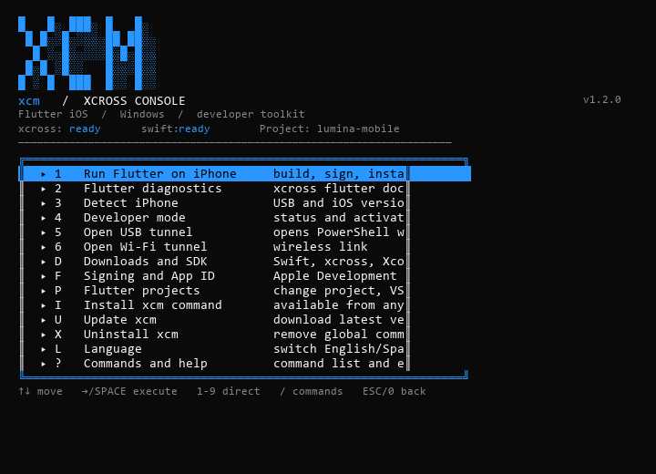

# XCross CLI (xcm) v1.2.0




[](https://github.com/Ameth1208/xcross-cli)

⭐ **If you find this useful, please star the repo!** It helps others discover it.
[](LICENSE)
[](https://ameth1208.github.io/xcross-cli/)


A terminal interface inspired by modern CLIs used with programming assistants. **It does not include an AI model**, but provides a fast keyboard-driven experience with a command palette and reusable commands.

> Windows-focused (PowerShell 5.1+). For a cross-platform Flutter setup helper, see `linux/setup-flutter.sh` (and `linux/linux-cli.sh` for Linux).

## Features

- Menu-driven TUI navigated with arrow keys (no Enter needed for most actions)
- Command palette (`/`) with fuzzy filtering
- Direct commands: `xcm help`, `xcm doctor`, `xcm device`, `xcm run`, `xcm sign`, etc.
- Guided installers for Swift, xcross and dependencies
- Project/bundle management for Flutter iOS builds
- USB/Wi-Fi tunnel helpers for device debugging
- No admin rights required for the global `xcm` command

## Live preview

See how the CLI menu looks: https://ameth1208.github.io/xcross-cli/

## Install from GitHub (no clone needed)

**Windows (PowerShell):**
```powershell
irm https://raw.githubusercontent.com/Ameth1208/xcross-cli/main/windows/xcm-install.ps1 | iex

## Language / Idioma

The CLI is bilingual (English by default, Spanish available):

```powershell
xcm language en
xcm language es

Or press `I` in the menu and confirm. Scripts are copied to `%LOCALAPPDATA%\Programs\XCrossCLI` and added to your user `PATH`. Open a **new terminal** to use `xcm` anywhere.

To remove it:

```powershell
powershell.exe -NoProfile -ExecutionPolicy Bypass -File .\windows\uninstall.ps1

Without the global command, replace `xcm` with `./windows/xcm.cmd` when inside the extracted folder.

## Flutter setup helper (`setup-flutter.sh`)

For a quick cross-platform Flutter environment setup:

```bash
chmod +x linux/setup-flutter.sh
./linux/setup-flutter.sh

## Linux CLI (`linux-cli.sh`)

A Linux counterpart of the Windows CLI. Run directly:

```bash
chmod +x linux/linux-cli.sh
./linux/linux-cli.sh            # interactive menu
./linux/linux-cli.sh doctor     # verify tools
./linux/linux-cli.sh help       # list commands
