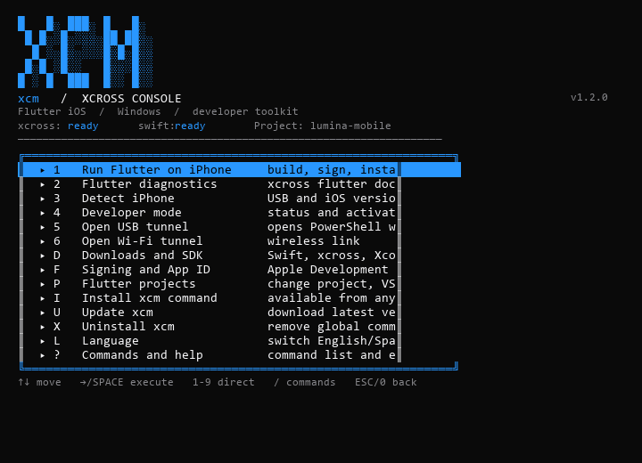

# XCross CLI (xcm) v1.5.4


Version 1.5.4 restores the complete main menu, help and `/` command palette.
`init` remains an additional option. The original XCM text logo appears in compact
terminals and help too; menu pagination reserves room for it.

## XCross is already set up: install directly

```powershell
xcm install ".\Koda.ipa"
```

As of 1.5.3, compiled unsigned/ad-hoc IPAs reuse the saved Windows XCross identity.
No second Apple login, WSL, xtool, zsign or manual P12 is required for this path.
The adapter pins XCross 2.1.2, provisions the app and supported embedded extensions,
signs a temporary copy and installs over USB. The original stays unchanged and a
`Koda-xcross-signed.ipa` copy is saved, with a suffix if the name already exists.

In a folder containing IPA files, `doctor` checks this workflow before selecting a
saved Flutter project. `init ipa` also reuses XCross. Apple validates compatibility
and account limits while signing. Koda v0.4 was installed with its Share/Widgets
extensions and its installed metadata was verified. Launch/playback was not tested.

## Everyday use: prepare once, then work

```powershell
xcm init
xcm install ".\Koda.ipa"
```

`init` detects the current project or remembers the selected workflow. Without
context it offers IPA installation, Flutter iOS and local Swift. Use `xcm init ipa`
for Koda: it checks XCross, its saved identity, signing tools and the USB iPhone,
asking for Apple login only without a saved identity. It does not install the app
or download Swift Linux/an SDK for an existing IPA. `xcm init ipa --check` diagnoses
without making those changes.

`xcm init flutter` opens Flutter preparation; `xcm init swift` prepares local Swift.
`setup`, argument-free `install` and `download all` are compatibility entry points
to the same assistant. Default help, the main menu and the palette show the full
command list; `xcm help --all` remains compatible. Outside recognized
projects, `doctor` remembers a selected IPA workflow.

Apple login now explains email + Enter, hidden password + Enter and 2FA + Enter
when requested. Wait during progress stages. Authentication runs directly in the
attached console without recording its input/output. XCross (Flutter) and xtool
(IPA) keep separate sessions; logging into one does not authenticate the other.
Renew an existing xtool login explicitly with `xcm xtool auth --refresh`.

## Advanced alternative: install compiled IPAs with xtool

Koda.ipa is already compiled, but its ad-hoc signature still needs device signing.
Use the new [xtool](https://github.com/xtool-org/xtool) backend through WSL without
zsign or a manual P12. XCross is the default; xtool must be explicitly selected:

```powershell
xcm update-cli
xcm version
xcm xtool install-tool
xcm xtool auth
xcm xtool connect-usb
xcm xtool devices
xcm xtool doctor
xcm install ".\Koda.ipa" --backend xtool
```

An installed WSL distribution is required. The installer verifies the official
AppImage's size and GitHub SHA256 before replacing the managed binary under
`~/.local/share/xcross-cli/xtool`. It does not change Linux PATH or require FUSE.
Login runs interactively without recording credentials; xtool and XCross sessions
are independent. `connect-usb` requests UAC to relay the Windows Apple Mobile Device
Service (iTunes/Apple Devices) to the WSL interface on port 27015. Its firewall rule
allows only that distribution's IP; rerun if the IP changes. Unlock and trust the
iPhone. USBIPD or an explicit `USBMUXD_SOCKET_ADDRESS` in WSL are alternatives.
Remove the relay and its firewall rule with `xcm xtool disconnect-usb`.
Select a distribution with `$env:XCM_WSL_DISTRO = 'Ubuntu-24.04'` or, for example,
`xcm xtool --distro Ubuntu-24.04 doctor`.

IPA menu **4** now signs and installs using xtool. Menu **6** retains manual zsign
signing. Automatic installation reuses XCross for ad-hoc signatures; explicitly
selecting `--backend xtool` authorizes provisioning/re-signing a temporary copy,
including supported extensions. The original archive stays unchanged; this flow
does not export a signed IPA. Apple account limits, capabilities and extension
compatibility still apply. `--backend xcross` keeps the earlier behavior. See
`xcm ipa logs` for installation logs; preflight errors print directly.

Installing an existing IPA needs neither Swift Linux nor Xcode.xip. Source builds
require Swift and a Darwin SDK inside WSL, and a project adapted with both
`Package.swift` and `xtool.yml`:

```powershell
xcm xtool sdk "C:\Downloads\Xcode.xip"
xcm xtool build --project "C:\repos\xtool-app" --configuration release
xcm xtool run --project "C:\repos\xtool-app"
```

`xcm run/build` also detects these projects. This does not automatically convert
iKoda's existing Xcode project to SwiftPM.

## Swift projects and maintenance (Windows)

Project selection and `run`, `build`, and `doctor` detect Flutter (`pubspec.yaml`),
SwiftPM (`Package.swift`), and native Xcode projects (`.xcodeproj` / `.xcworkspace`
at the selected root). Selection prefers `--project`, then the current directory,
then the saved project; existing settings remain compatible. Select the actual
project directory inside a monorepo. A SwiftPM root with `xtool.yml` uses xtool's
iOS backend through WSL instead of running on Windows.

SwiftPM builds and runs **on Windows**, requiring Windows-compatible dependencies.
Libraries can be built; running requires an executable product. This does not add
an iPhone SwiftUI/UIKit compiler:

```powershell
xcm build --project "C:\repos\swift-package" --configuration release
xcm run --project "C:\repos\swift-package" --product MyExecutable --args "hello world"
xcm doctor --project "C:\repos\swift-package"
xcm doctor --environment
xcm download all
xcm update --check
xcm update
xcm update --force
xcm update --check --ref main
xcm update-cli
xcm update-cli --local
```

`doctor` runs XCross's iOS diagnostics for Flutter or checks Swift and the package
manifest for SwiftPM; the latter does not prove dependencies build. `--environment`
checks host tools and XCross configuration without requiring a project or verifying
the Darwin SDK, signing, or devices. `verify` and `check` alias `doctor`. Failed
checks return exit code 1.

`download all` opens guided setup for Swift, XCross, dependencies, optional SDK
import and final diagnostics. Flutter artifacts are offered only for Flutter
projects. Obtain **Xcode.xip manually from Apple**; setup cannot download it.
Installer confirmations remain interactive.

`update` updates the **XCross engine**, with read-only `--check`, release reinstall
via `--force`, and engine-supported `--ref` selection. Failed checks stop the update;
successful updates print the installed version. `update-cli` updates **xcm**.
The remote xcm installer pins all downloads to one commit, validates PowerShell
scripts before copying, and restores previous files if copying fails. Local
installation validates package completeness and PowerShell syntax before copying.

[iKoda](https://github.com/Ivorisnoob/iKoda) is a native Xcode app with SwiftUI and
extensions. The current Windows XCross backend has no native Xcode project build
command. The CLI detects that limitation and returns an error instead of treating
the app or its core library as Flutter. Building the unmodified project uses
Xcode; building without a Mac requires adapting the app and extensions to xtool. To
download an already published IPA:

```powershell
xcm download ipa --repo Ivorisnoob/iKoda --asset Koda.ipa --output .\Koda.ipa
xcm ipa inspect .\Koda.ipa
```

This downloads the exact asset from the latest stable release, checks its size and
GitHub SHA256 when available, inspects the IPA, and refuses existing output paths.
It requires Internet and Python, respects public GitHub API limits, warns when no
checksum is published, and does not install on a device. iKoda v0.4 was verified
to have an **ad-hoc signature**: it needs device signing, including its extensions.
Use the default saved XCross identity in 1.5.3, or explicitly select an alternative.
Downloading alone does not make this IPA installable. Inspection covers the main
executable, not all extensions.



[](https://github.com/Ameth1208/xcross-cli)

⭐ **If you find this useful, please star the repo!** It helps others discover it.
[](LICENSE)
[](https://ameth1208.github.io/xcross-cli/)


A terminal interface inspired by modern CLIs used with programming assistants. **It does not include an AI model**, but provides a fast keyboard-driven experience with a command palette and reusable commands.

> Windows-focused (PowerShell 5.1+). For a cross-platform Flutter setup helper, see `linux/setup-flutter.sh` (and `linux/linux-cli.sh` for Linux).

## Features

- Menu-driven TUI navigated with arrow keys (no Enter needed for most actions)
- Command palette (`/`) with fuzzy filtering
- Direct commands: `xcm help`, `xcm doctor`, `xcm device`, `xcm run`, `xcm sign`, etc.
- Guided installers for Swift, xcross and dependencies
- Project/bundle management for Flutter iOS builds
- USB/Wi-Fi tunnel helpers for device debugging
- Direct USB installation of existing signed IPAs on Windows: `xcm install "app.ipa"`
- Optional IPA signing, Flutter IPA builds, and Git updates from the current directory
- No admin rights required for the global `xcm` command

## Live preview

See how the CLI menu looks: https://ameth1208.github.io/xcross-cli/

## Install from GitHub (no clone needed)

**Windows (PowerShell):**
```powershell
irm https://raw.githubusercontent.com/Ameth1208/xcross-cli/main/windows/xcm-install.ps1 | iex
```

## Language / Idioma

The CLI is bilingual (English by default, Spanish available):

```powershell
xcm language en
xcm language es
```

Or press `I` in the menu and confirm. Scripts are copied to `%LOCALAPPDATA%\Programs\XCrossCLI` and added to your user `PATH`. Open a **new terminal** to use `xcm` anywhere.

To remove it:

```powershell
powershell.exe -NoProfile -ExecutionPolicy Bypass -File .\windows\uninstall.ps1
```

Without the global command, replace `xcm` with `./windows/xcm.cmd` when inside the extracted folder.

## Flutter setup helper (`setup-flutter.sh`)

For a quick cross-platform Flutter environment setup:

```bash
chmod +x linux/setup-flutter.sh
./linux/setup-flutter.sh
```

## Linux CLI (`linux-cli.sh`)

A Linux counterpart of the Windows CLI. Run directly:

```bash
chmod +x linux/linux-cli.sh
./linux/linux-cli.sh            # interactive menu
./linux/linux-cli.sh doctor     # verify tools
./linux/linux-cli.sh help       # list commands
```

## Build, sign and install IPA files (Windows)

Install an existing IPA using your saved XCross signing configuration:

```powershell
xcm install "C:\Apps\my-app.ipa"
```

The CLI inspects the main executable first. An existing device signature is preserved and installed through `pymobiledevice3`. Unsigned/ad-hoc packages use the saved XCross identity for provisioning, signing a copy and installation. `--backend xtool` explicitly selects the WSL alternative. No manual P12 is requested. Encrypted binaries and incompatible platforms are rejected. iOS performs final validation. Connect an unlocked, trusted iPhone over USB. Press **7** in the main menu for this workflow. `xcm install` without arguments keeps the guided setup.

Open `xcm ipa` or run:

```powershell
xcm ipa build --mode release
xcm ipa build --project "C:\projects\my-app" --target lib/main.dart --flavor staging
xcm ipa sign ".\my-app.ipa" --certificate ".\certificate.p12" --profile ".\app.mobileprovision" --output ".\my-app-signed.ipa"
xcm ipa install ".\my-app-signed.ipa" --udid "IPHONE-UDID"
```

Build uses `xcross flutter build --ipa` with `debug`, `profile` or `release` (default). Project resolution prefers `--project`, then the current Flutter folder, then the saved project. Building requires the XCross iOS toolchain; the resulting IPA still needs a valid development or distribution signature for device installation.

Signing existing IPAs requires [zsign for Windows](https://github.com/zhlynn/zsign#build) on PATH, a `.p12` containing the private key, and a compatible `.mobileprovision` profile. XCross 2.1.2 has no standalone IPA signing command. The P12 password is prompted securely and never saved or printed; zsign receives it as a process argument. Optional `--bundle-id` changes the identifier if the profile permits it. Output defaults to `name-signed.ipa` beside the original; existing output files are rejected. Apps with extensions needing separate profiles require more specific signing configuration through zsign.

Install uses `pymobiledevice3 apps install --streaming` for an existing signed IPA. Connect and unlock your iPhone over USB and accept Trust. Omit `--udid` for a single connected device; multiple devices require a selection. iOS validates the signature and profile during installation. This does not make encrypted App Store packages installable.

IPA, certificate and profile paths are relative to the caller's current directory. `xcm sign` keeps its signing diagnostics behavior; use `xcm ipa sign` or `xcm sign-ipa` for signing. `xcm build` and `xcm install-ipa` are also available.

## Update from the current directory

```powershell
xcm project update
xcm project update "C:\projects\my-app"
xcm update-cli --local
```

`project update` (alias `update-project`) updates the Git repository in the current directory, including non-Flutter projects. It requires a clean working tree and an upstream branch, then runs `git pull --ff-only`. Divergent history fails without merging or discarding local work. The saved Flutter project does not affect this command.

Run `update-cli --local` from this package's root or its `windows` folder to install the local scripts into `%LOCALAPPDATA%\Programs\XCrossCLI` and register the user PATH. This activates local changes without publishing. `xcm update-cli` still downloads from GitHub; `xcm update` updates XCross itself. Without a global installation, use `.\windows\xcm.cmd` instead of `xcm` from this folder.

## Inspection and automatic signing

```powershell
xcm ipa inspect ".\app.ipa"
xcm ipa logs
```

Inspection is read-only and checks signature presence in the main executable, not trust, expiry or every embedded bundle. Installation errors are summarized; full details remain in `%APPDATA%\XCrossMenu\logs`. Menus now paginate and adapt labels to terminal width.

Automatic signing uses the native XCross 2.1.2 engine pinned to commit `29af3b65f302e6cb1ca653cb78b1f9a096e091ca` and its existing credentials. It needs installed XCross, Git and Dart 3.10+ (Flutter's bundled Dart is detected). The first run downloads the pinned sources and lockfile-verified dependencies. It does not build the app or require its project. The adapter loads the native library bundled with installed XCross on Windows. If the Apple session is unusable, renew it with `xcm auth`.

The original IPA stays intact. The signed copy is saved beside it as `app-xcross-signed.ipa` (with a unique suffix when that path exists). XCross may qualify the bundle identifier with the team's prefix according to its configuration. Verified by signing/installing a real unsigned IPA and then reinstalling its signed copy on a USB iPhone; app launch and app functionality were not tested.

`windows/xcross_ipa_bridge.dart` is AGPL-3.0-only and uses the XCross engine (AGPL-3.0). The remaining CLI retains its MIT license.
